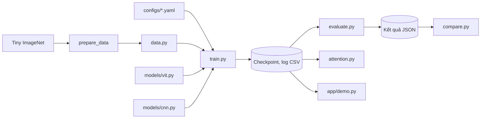

# Kiến trúc tổng

Chi tiết từng thành phần nằm ở file riêng; file này chỉ giữ phần dùng chung. Các quyết định thiết kế ở [09_decisions.md](09_decisions.md).

## Hiện trạng
- Đã có tiện ích, dữ liệu, DataLoader, ViT và CNN (TASK-001 đến 005). `src/train.py` (TASK-006) và attention (TASK-008) đã gộp vào `main`; chưa có đánh giá test hay demo.
- Tái sử dụng `torchvision`: transform, RandAugment, CIFAR-100.
- Cấu trúc thư mục code lấy từ mục 4 của [spec](../SPEC_ViT.md), với gốc repo là gốc project (DEC-004).

## Sơ đồ

| Thành phần | Code | Người giữ | Tài liệu |
|---|---|---|---|
| Dữ liệu | `scripts/prepare_data.py`, `src/data.py` | TV1 | [04_data.md](04_data.md) |
| Mô hình | `src/models/vit.py`, `src/models/cnn.py` | TV2, TV3 | [05_model.md](05_model.md) |
| Huấn luyện | `src/train.py` | TV4 | [06_training.md](06_training.md) |
| Đánh giá, attention, so sánh | `src/evaluate.py`, `scripts/error_analysis.py`, `src/attention.py`, `src/compare.py` | TV5, TV2 | [07_evaluation.md](07_evaluation.md) |
| Demo | `app/demo.py` | TV5 | [08_demo.md](08_demo.md) |
| Tiện ích dùng chung | `src/utils.py` (nạp config, seed, ghi file an toàn) | TV1 | File này |

## Luồng làm việc
1. Chuẩn bị dữ liệu và kiểm tra số lượng.
2. Chạy `--quick` để kiểm tra pipeline.
3. Đo thời gian mỗi epoch, chốt số thí nghiệm.
4. Train ViT và CNN, chọn checkpoint trên validation.
5. Đánh giá test một lần, sinh bảng so sánh.
6. Trực quan hóa attention, chạy demo, viết báo cáo.

## Hợp đồng dùng chung

Hợp đồng riêng của từng thành phần nằm ở file của bên tạo ra nó:

| Hợp đồng | Ở đâu |
|---|---|
| Gọi mô hình, `return_attn` | [05_model.md](05_model.md) |
| Tên lần chạy, checkpoint, log CSV | [06_training.md](06_training.md) |
| Kết quả JSON | [07_evaluation.md](07_evaluation.md) |
| Config YAML | Dưới đây |

Muốn đổi hợp đồng nào thì sửa tài liệu và báo cả nhóm trước.

**Config YAML** (`configs/vit_small.yaml`, `configs/cnn_baseline.yaml`), các khóa bắt buộc do `load_config` trong `src/utils.py` kiểm tra:
- `run_name`, `seed`
- `data`: `name, root, cache_dir, img_size, num_classes, batch_size, num_workers, val_ratio, mean, std`
- `model`: `name`
- `train`: `epochs, optimizer, lr, weight_decay`

| Mã | Điều kiện ban đầu | Thao tác | Kết quả mong đợi |
|---|---|---|---|
| AC-013 | Config thiếu khóa bắt buộc | Nạp config | `load_config` báo lỗi nêu tên khóa thiếu |

## Môi trường

| Thành phần | Giá trị |
|---|---|
| Máy viết tài liệu | Windows 10, Python 3.13.9, PyTorch 2.9.1+cpu, không có GPU; chưa cài `gradio`, `thop`, `fvcore` |
| Máy train | Máy của một thành viên, GPU 6GB VRAM, máy rảnh (theo thông tin nhóm, chưa kiểm tra trực tiếp) |
| Dự phòng | Kaggle hoặc Colab, chưa kiểm tra |
| Phiên bản tối thiểu | Python 3.10+ |

**Lệnh chung:**

| Mục đích | Lệnh | Trạng thái |
|---|---|---|
| Cài đặt | `pip install -r requirements.txt` (máy GPU: cài torch bản CUDA trước) | Chưa thử trên máy sạch |
| Test | `python -m pytest` ở gốc repo | Đã chạy 2026-11-19 trên máy TV1 (CPU): 52 passed |
| Chuẩn bị dữ liệu | `python scripts/prepare_data.py --download` | Đã chạy 2026-11-16 trên máy TV1 |

Lệnh của từng thành phần nằm trong file thành phần đó.

## Dữ liệu và bí mật
- Không commit `kaggle.json`, dữ liệu hay checkpoint. Checkpoint lưu trên Google Drive hoặc Kaggle Dataset, link ghi trong README.
- `.gitignore` chặn `data/`, `outputs/checkpoints/`, `*.pt`, `*.pth`, `kaggle.json`; không chặn `outputs/logs`, `outputs/results`, `src/`, `configs/`, `workflow/`. Đã kiểm tra từng đường dẫn bằng `git check-ignore` ngày 2026-11-15.
- Dự án không có phân quyền người dùng.
