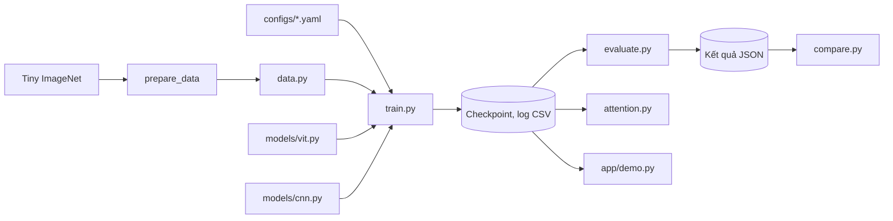

# Khảo sát và thiết kế

## Khảo sát dự án hiện có
- **Cấu trúc và luồng xử lý liên quan:** Repo mới, chưa có code, dữ liệu hay mô hình.
- **File có thể tái sử dụng:**
  - `torchvision`: transform, RandAugment, CIFAR-100.
- **Ràng buộc và điểm cần chú ý:** Máy viết tài liệu chỉ có CPU (Python 3.13.9, PyTorch 2.9.1+cpu); train trên máy GPU 6GB VRAM của một thành viên, máy rảnh; cấu trúc thư mục lấy từ mục 4 của spec.

## Thiết kế đề xuất

### Kiến trúc và trách nhiệm



| Thành phần | Trách nhiệm | Đáp ứng |
|---|---|---|
| `scripts/prepare_data.py` | Giải nén, sắp xếp `val/`, kiểm tra số lượng, chia train/validation, xuất mảng cache `.npy`, xuất thống kê | FR-001 |
| `src/data.py` | Đọc mảng cache, augmentation, DataLoader | FR-001 |
| `src/models/vit.py` | ViT tự cài, attention hai nhánh (train dùng `scaled_dot_product_attention`, `return_attn=True` tính tường minh) | FR-002 |
| `src/models/cnn.py` | ResNet nhỏ, `match_param_count` | FR-003 |
| `src/train.py` | Vòng lặp train, resume, log | FR-004 |
| `src/evaluate.py`, `scripts/error_analysis.py` | Chỉ số trên test, phân tích lỗi | FR-005 |
| `src/attention.py` | CLS attention, attention rollout | FR-006 |
| `src/compare.py` | Bảng và biểu đồ | FR-007 |
| `app/demo.py` | Giao diện Gradio | FR-008 |
| `src/utils.py` | Tiện ích dùng chung | FR-004, FR-005, FR-007 |

### Luồng nghiệp vụ

1. Chuẩn bị dữ liệu và kiểm tra số lượng.
2. Chạy `--quick` để kiểm tra pipeline.
3. Đo thời gian mỗi epoch, chốt số thí nghiệm.
4. Train ViT và CNN, chọn checkpoint trên validation.
5. Đánh giá test một lần, sinh bảng so sánh.
6. Trực quan hóa attention, chạy demo, viết báo cáo.

### Dữ liệu

| Tập | Nguồn | Số ảnh | Dùng để |
|---|---|---|---|
| Train | 90% train gốc, phân tầng | 90.000 | Huấn luyện, có augmentation |
| Validation | 10% train gốc, phân tầng | 10.000 | Chọn siêu tham số, checkpoint |
| Test | Val gốc | 10.000 | Số cuối, chỉ sau khi chốt cấu hình |

**Ràng buộc:** train và validation không trùng ảnh; validation và test chỉ ToTensor + Normalize; test gốc không nhãn bị bỏ qua.

**Cache:** `prepare_data.py` xuất train/val/test thành mảng `uint8` (.npy) đã resize về `img_size`, DataLoader đọc từ mảng này vì giải mã JPEG và augmentation trên CPU thường là nút thắt. Dữ liệu cache khoảng 1,35 GB (tính tay); chạy lại không làm hỏng.

### Mô hình học máy

| Mô hình | Cấu hình | Số tham số |
|---|---|---|
| ViT-small | Ảnh 64, patch 8, dim 256, depth 8, heads 8, MLP ratio 4, drop path 0,1 | 6.436.296 (tính tay, đã kiểm tra lại bằng phép tính, chưa xác minh bằng code) |
| ResNet nhỏ | BasicBlock, BatchNorm, stem 3x3 stride 1 nhưng tầng đầu tiên downsample sớm, hoặc stem stride 2 (tránh feature map 64x64 ở nhiều tầng, vì tốn VRAM và thời gian); cấu hình cuối do `match_param_count` chọn | Trong khoảng 5% so với ViT (chưa xác minh) |

Cùng cỡ tham số nhưng chi phí tính toán có thể chênh nhiều. **Dự đoán, chưa đo bằng code:** ViT khoảng 0,43 GMACs (khoảng 0,86 GFLOPs), CNN khoảng 1–1,5 GMACs. Số của CNN tính cho stem cũ chưa downsample; thiết kế downsample sớm (DEC-007) có thể thấp hơn, phải đo. Khi đo, ghi rõ đơn vị (MACs hay FLOPs) và dùng cùng một đơn vị cho cả hai mô hình.

**Huấn luyện:** AdamW, batch 64, lr ViT 2,5e-4, ViT và CNN cùng batch, warmup 5 epoch rồi cosine về 1e-5 (cập nhật theo từng iteration, cosine tính trên tổng 50 epoch), weight decay 0,05, label smoothing 0,1, gradient clipping 1,0, Mixup/CutMix với xác suất 0,5 mỗi batch (bật/tắt và xác suất trong config), RandomErasing mặc định tắt, AMP khi có GPU, 50 epoch. Chọn checkpoint tốt nhất theo validation Top-1.

**Đánh giá:** Top-1, Top-5 trên test; per-class accuracy; top 20 cặp lớp nhầm. Train accuracy không dùng để nhận xét khi bật Mixup/CutMix. Ablation chỉ báo kết quả trên validation. Test chỉ dùng cho các mô hình chính cuối cùng (ViT và CNN).

### Giao tiếp giữa các phần

Các hợp đồng này để 5 thành viên làm song song. Muốn đổi thì sửa ở đây và báo cả nhóm.

**Mô hình**
```python
logits = model(x)                         # x: (B,3,H,W), logits: (B,num_classes)
logits, attns = vit(x, return_attn=True)  # chỉ ViT; attns: list[(B,heads,N+1,N+1)], mỗi layer một phần tử
```

**Checkpoint** (`.pt`): `model`, `optimizer`, `scheduler`, `epoch`, `best_val_top1`, `config`, `seed`. Checkpoint chỉ chứa tensor, dict, list, số và chuỗi; không lưu đối tượng Python hay trạng thái RNG của numpy, để `weights_only=True` nạp được; trạng thái RNG nếu cần lưu thành tensor.

**Log CSV** (`outputs/logs/<run_name>.csv`): `epoch, train_loss, train_acc, val_loss, val_top1, val_top5, lr, epoch_time_s`.

**Kết quả JSON** (`outputs/results/<run_name>.json`): `run_name, model, seed, params, top1, top5, epoch_time_s, inference_img_per_s`. Chưa có số thì để `null`.

**Config YAML**, các khóa bắt buộc:
- `run_name`, `seed`
- `data`: `name, root, img_size, num_classes, batch_size, num_workers, val_ratio`
- `model`: `name`
- `train`: `epochs, optimizer, lr, weight_decay`

### Xử lý lỗi, nhất quán dữ liệu

| Tình huống | Cách xử lý |
|---|---|
| Thiếu dữ liệu, sai số lượng | `prepare_data` dừng và báo rõ |
| Config thiếu khóa | `load_config` báo lỗi nêu tên khóa |
| Train bị ngắt (máy GPU tắt, mất điện, phiên Kaggle/Colab hết giờ) | Ghi file tạm rồi đổi tên, chạy lại bằng `--resume` |
| Resume từ checkpoint cũ hơn log | Các dòng log từ epoch đó trở đi được ghi đè |
| Checkpoint từ người khác | Nạp với `weights_only=True` |

Dự án không có phân quyền người dùng.

## Quyết định thiết kế

| Mã | Quyết định | Vì sao | Lựa chọn khác và đánh đổi | Trạng thái |
|---|---|---|---|---|
| DEC-001 | Tiny ImageNet là dữ liệu chính, CIFAR-100 dự phòng | Có sẵn link trong đề, ảnh lớn hơn | CIFAR-100 nhẹ hơn nhưng ảnh 32x32 | Đề xuất |
| DEC-002 | AdamW cho cả hai mô hình trong so sánh chính | So sánh công bằng | SGD có thể tốt hơn cho CNN, chỉ làm tham khảo | Đề xuất |
| DEC-003 | Batch 64, lr ViT 2,5e-4, ViT và CNN cùng batch | Dự đoán vừa 6GB VRAM, chưa đo; scale tuyến tính từ 1e-3 ở batch 256 | Batch 128 qua gradient accumulation 2 bước (giữ lr 5e-4, không tốn thêm VRAM, nhưng epoch không nhanh hơn và BatchNorm của CNN chỉ gần tương đương) | Đề xuất |
| DEC-004 | Thư mục gốc repo là gốc project | Tránh lồng thêm `vit-tiny-imagenet/` | Thư mục con như spec cũ, đường dẫn dài hơn | Đề xuất |
| DEC-005 | Ghi checkpoint và log qua file tạm | Phiên bị ngắt lúc ghi không hỏng file cũ | Ghi trực tiếp đơn giản hơn nhưng có thể mất checkpoint | Đề xuất |
| DEC-006 | Tự cài ViT thay vì dùng `timm` | Dễ chỉnh số tham số và lấy attention | `timm` nhanh hơn; đề không bắt buộc tự cài | Đề xuất |
| DEC-007 | CNN dùng stem 3x3 stride 1 nhưng tầng đầu tiên downsample sớm, hoặc stem stride 2 (tránh feature map 64x64 ở nhiều tầng, vì tốn VRAM và thời gian) | Giảm VRAM và thời gian, vẫn khớp tham số trong 5% qua `match_param_count` | Stem stride 1 không downsample sớm giữ chi tiết hơn nhưng nặng; chọn cách nào sẽ ghi lại ở đây | Đề xuất |

## Rủi ro kỹ thuật

| Rủi ro | Ảnh hưởng | Cách kiểm chứng hoặc xử lý |
|---|---|---|
| Chỉ một máy GPU, các lần train phải chạy lần lượt | Không đủ thí nghiệm | Dự đoán, ước tính thô, chưa đo: ViT khoảng 1–2 phút/epoch, CNN khoảng 3–6 phút/epoch trên GPU 6GB cỡ phổ thông, nên 50 epoch cho cả hai khoảng 4–6 giờ. Số của CNN tính cho stem cũ chưa downsample, thiết kế mới có thể nhanh hơn. Phải đo thật trước khi chốt số epoch. Đo thời gian ngày 11/11; cắt việc theo mục 20 spec; Kaggle hoặc Colab dự phòng |
| 6GB VRAM không đủ, nhất là CNN và ablation patch 4 | Lỗi hết bộ nhớ | Đo VRAM đỉnh bằng `--quick` trên máy GPU trước khi train thật; nếu lỗi thì dùng gradient accumulation hoặc giảm batch còn 32 với cả hai mô hình; phần làm thêm có thể dùng batch riêng hoặc Kaggle/Colab |
| Máy GPU hỏng hoặc chủ máy bận | Trễ toàn bộ train | Sao lưu checkpoint ra ngoài máy; chuyển sang Kaggle hoặc Colab và `--resume` |
| Tải dữ liệu Kaggle bị vướng | Trễ toàn bộ | TV4 tải thử sớm; đến 10/11 chưa được thì chuyển CIFAR-100 |
| ViT thua xa CNN | Kết quả kém nhưng vẫn hợp lệ | Báo cáo trung thực, phân tích nguyên nhân |
| Rò rỉ dữ liệu test | Kết quả mất giá trị | Chỉ `evaluate.py` đọc test, chạy sau khi chốt cấu hình |
| Mixup/CutMix có thể lợi cho ViT hơn CNN | So sánh thiên lệch | Nêu trong báo cáo; ablation nếu còn thời gian |

## Điểm cần người phụ trách kiểm tra
- [ ] Thiết kế đáp ứng các yêu cầu trong phạm vi.
- [ ] Luồng lỗi và dữ liệu được xử lý phù hợp.
- [ ] Người phụ trách giải thích được phương án.
- [ ] Quyết định còn chưa chốt đã được ghi rõ.

Chỉ đánh dấu sau khi đã kiểm tra. Khi đổi thiết kế, cập nhật lý do và các đầu việc bị ảnh hưởng.
