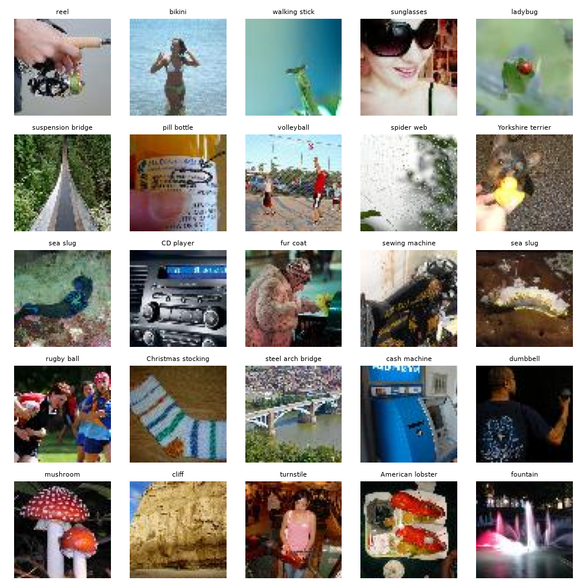
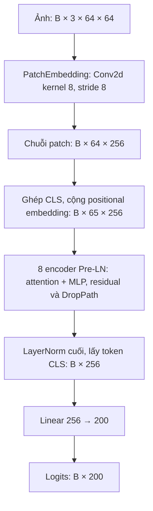
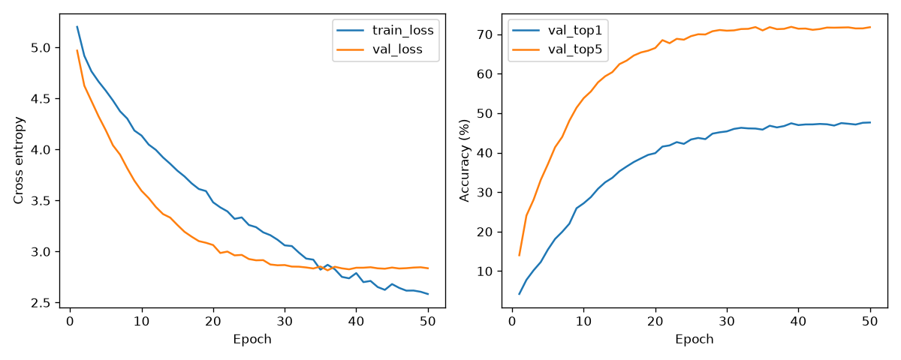
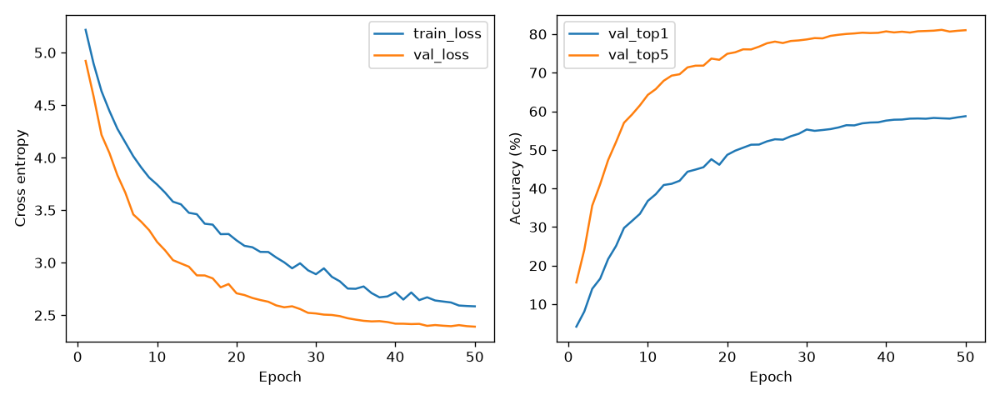
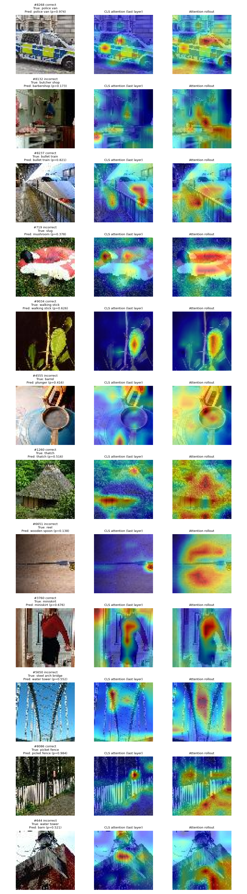
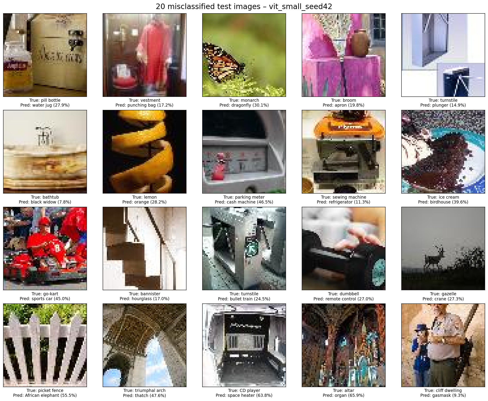
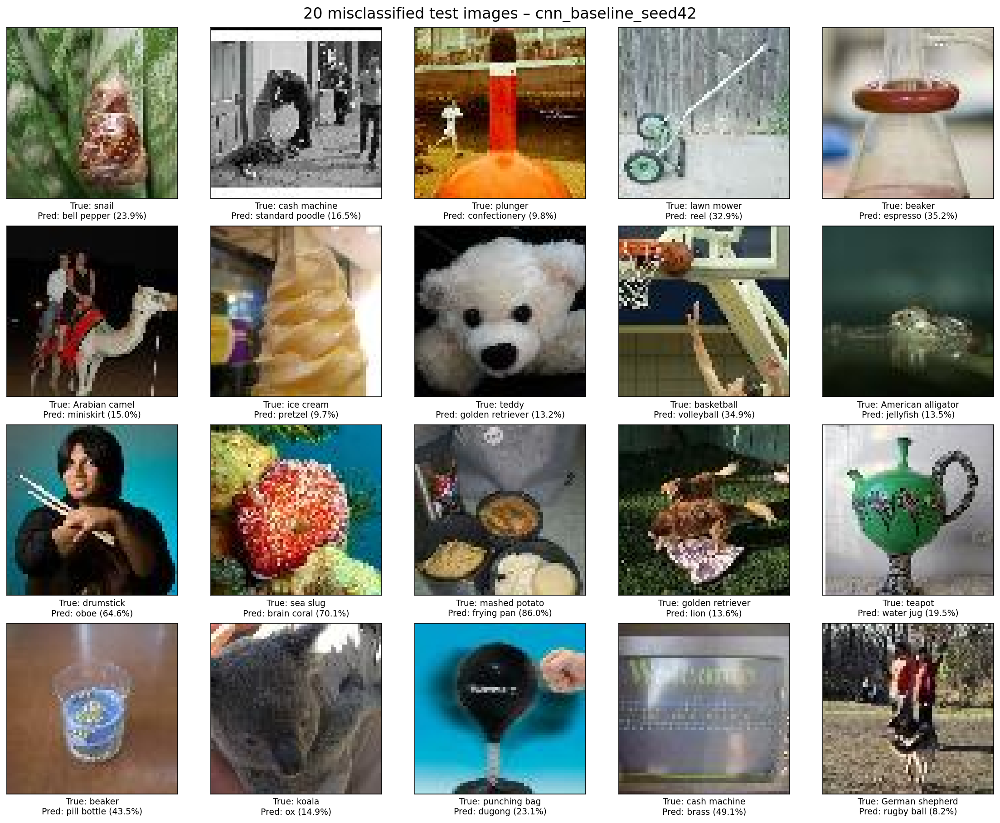

# Báo cáo: Phân loại ảnh Tiny ImageNet bằng Vision Transformer

> **Bản nháp, cập nhật ngày 2026-11-20.** Khung theo mục 15 của [spec](../SPEC_ViT.md). Đã có mục 2 (dữ liệu), 3.1–3.3, 4.1–4.2 (ViT, CNN, huấn luyện, kết quả validation) và mục 6 (attention trên checkpoint thật). Chưa có đánh giá test cuối.

**Phân công viết** (theo mục 19 spec; TV5 ghép bản cuối):

| Mục | Người viết | Viết khi có |
|---|---|---|
| 1, 2, 8, 9 | TV1 | 2 đã có; 1 viết ngay; 8, 9 sau khi có train, đánh giá, demo |
| 3.1, 6 | TV2 | Đã có kiến trúc và hình attention thật; TASK-008 xong (PR #6) |
| 3.2, 6.4 (Grad-CAM, nếu làm) | TV3 | Sau TASK-005 |
| 3.3, 4 | TV4 | Sau TASK-006, TASK-011 |
| 5, 7, 10 | TV5 | Sau TASK-007, TASK-009 |

**Quy tắc chung khi viết:**
- Mọi con số phải dẫn về file trong `outputs/results/` hoặc `outputs/logs/`; chưa có thì ghi "chưa có" (mục 17 spec).
- Không dùng tập test để chọn cấu hình hay checkpoint; số trên test chỉ chạy một lần sau khi chốt.
- Hình để trong `outputs/figures/`, chèn bằng đường dẫn tương đối.
- Mỗi mục bắt đầu bằng danh sách "Cần có" bên dưới; viết xong thì xóa danh sách đó.

## 1. Vấn đề và phạm vi

*Người viết: TV1.* Chưa viết.

Cần có: bài toán; vì sao chọn ViT và so sánh với CNN cùng số tham số; phạm vi bắt buộc (ViT tự cài, baseline CNN, attention) và phần mở rộng. Nguồn: [docs/01_define.md](../docs/01_define.md).

## 2. Dữ liệu

*Người viết: TV1.*

**Nguồn.** Tiny ImageNet của Stanford CS231n, tải từ `https://cs231n.stanford.edu/tiny-imagenet-200.zip` (248 MB). Repo không chứa dữ liệu; `python scripts/prepare_data.py --download` tải và chuẩn bị lại trên mọi máy (DEC-015).

**Quy mô.** 200 lớp, ảnh RGB 64 × 64. Bộ gốc có 100.000 ảnh train (500 ảnh/lớp), 10.000 ảnh val có nhãn và 10.000 ảnh test không có nhãn.

**Chia tập.** Tập test gốc không có nhãn nên bị bỏ. Để có tập chọn cấu hình riêng và tập đánh giá cuối không bị dùng trong lúc phát triển, nhóm chia như sau:

| Tập | Lấy từ | Số ảnh | Mỗi lớp | Dùng để |
|---|---|---|---|---|
| Train | 90% train gốc, chia phân tầng, seed 42 | 90.000 | 450 | Huấn luyện, có augmentation |
| Validation | 10% còn lại của train gốc | 10.000 | 50 | Chọn siêu tham số và checkpoint |
| Test | Val gốc | 10.000 | 50 | Đánh giá cuối, chạy một lần |

Train và validation lấy từ hai tập chỉ số không giao nhau. Số lượng đọc từ [dataset_stats.json](../outputs/results/dataset_stats.json) và đã đếm lại trên mảng nhãn của cache ngày 2026-11-16.

**Tiền xử lý.** Ảnh được giải mã một lần và lưu thành mảng `uint8` (tổng 1,35 GB) để DataLoader không phải đọc 110.000 file JPEG mỗi epoch. Chuẩn hóa bằng mean/std của ImageNet. Augmentation khi train: RandomCrop 64 với padding 4, lật ngang, RandAugment; validation và test chỉ chuẩn hóa. Mixup/CutMix áp ở vòng lặp train (mục 3.3).



*Hình 1. 25 ảnh ngẫu nhiên từ tập train (seed 42). Tên lớp lấy từ [class_names.json](../outputs/results/class_names.json).*

## 3. Phương pháp

### 3.1. Kiến trúc ViT (TV2)

Vision Transformer biểu diễn ảnh thành một chuỗi patch và dùng Transformer để xử lý quan hệ giữa các patch. Ý tưởng chia ảnh thành token và sử dụng token phân loại được tham khảo từ [Dosovitskiy và cộng sự](https://arxiv.org/abs/2010.11929). Trong đồ án, nhóm tự cài mô hình bằng PyTorch, không sử dụng ViT dựng sẵn hoặc trọng số pretrained.

Biến thể dùng trong repo có tên cấu hình `vit_small`. Các kích thước và siêu tham số dưới đây được lấy từ [vit_small.yaml](../configs/vit_small.yaml); đây là cấu hình riêng của đồ án.

| Thuộc tính | Giá trị |
|---|---|
| Ảnh đầu vào | RGB, 64 × 64 |
| Patch | 8 × 8, không chồng lấn |
| Số patch / tổng số token có CLS | 64 / 65 |
| Chiều embedding | 256 |
| Số encoder block | 8 |
| Số attention head mỗi block | 8 |
| MLP ratio | 4 |
| Dropout | 0,0 |
| DropPath lớn nhất | 0,1 |
| Số lớp đầu ra | 200 |
| Số tham số đã đếm bằng code | 6.436.296 |

Số tham số và shape forward mặc định đã được kiểm tra, lưu tại [task004_vit_checks.json](../outputs/results/task004_vit_checks.json). Mã nguồn mô hình nằm trong [vit.py](../src/models/vit.py).



**Patch embedding và vị trí.** Với ảnh vuông cạnh $H$ và patch cạnh $P$, số patch là $N=(H/P)^2$. `PatchEmbedding` dùng Conv2d có kernel và stride bằng $P$, sau đó trải phẳng hai chiều không gian thành chuỗi. Một CLS token học được được ghép ở đầu chuỗi để tổng hợp thông tin phục vụ phân loại. Positional embedding học được có shape `(1,N+1,D)` được cộng vào chuỗi để biểu diễn vị trí của từng token. Trong cấu hình mặc định, chuỗi sau bước này có shape `(B,65,256)`.

**Encoder Pre-LN.** Mỗi block áp LayerNorm trước attention và trước MLP, với hai kết nối residual:

$$
U_l = Z_{l-1} + \operatorname{DropPath}_l\bigl(\operatorname{MSA}(\operatorname{LN}_1(Z_{l-1}))\bigr),
$$

$$
Z_l = U_l + \operatorname{DropPath}_l\bigl(\operatorname{MLP}(\operatorname{LN}_2(U_l))\bigr).
$$

MSA là multi-head self-attention. MLP gồm Linear mở rộng chiều embedding theo `mlp_ratio`, GELU, dropout, Linear đưa về chiều ban đầu và dropout. `DropPath` bỏ toàn bộ nhánh residual theo từng ảnh khi train, đồng thời chia cho xác suất giữ nhánh để bảo toàn kỳ vọng. Xác suất bỏ nhánh tăng tuyến tính theo độ sâu, từ 0 đến 0,1 ở cấu hình mặc định. Khi `eval()`, DropPath và dropout đều tắt.

**Hai nhánh attention.** Từ embedding của mỗi token, một Linear chung tạo $Q$, $K$, $V$, rồi chia thành các head. Với chiều mỗi head là $d_h$:

$$
A = \operatorname{softmax}\left(\frac{QK^T}{\sqrt{d_h}}\right),
\qquad O = \operatorname{Dropout}(A)V.
$$

Nhánh forward thường dùng `torch.nn.functional.scaled_dot_product_attention` để tính attention; khi eval, xác suất dropout được truyền tường minh là 0. Nhánh `return_attn=True` tính công thức trên trực tiếp, dùng chung trọng số qkv/proj và trả thêm $A$ **trước dropout**. Mỗi layer trả một tensor `(B,heads,N+1,N+1)`. Nhánh này cung cấp đầu vào cho phần trực quan hóa; bản thân việc trả weights chưa tạo ra hình attention hoặc chứng minh chất lượng dự đoán.

**Head và khởi tạo.** Sau encoder cuối, LayerNorm được áp lên chuỗi, lấy biểu diễn CLS và đưa qua Linear để tạo logits. Mô hình không softmax logits, để bên huấn luyện có thể dùng CrossEntropyLoss. Trọng số Linear, CLS token và positional embedding được khởi tạo bằng truncated normal với độ lệch chuẩn 0,02; bias Linear bằng 0, LayerNorm có weight bằng 1 và bias bằng 0. Đây là các giá trị khởi tạo trong code, không phải kết quả huấn luyện.

**Tích hợp.** Các thành phần khác tạo mô hình qua `build_model(cfg)` trong [src/models/__init__.py](../src/models/__init__.py). Hàm lấy `img_size`, `num_classes` từ phần `data` và các thuộc tính kiến trúc từ phần `model`, không sửa config của bên gọi. Mô hình báo lỗi nếu kích thước ảnh không chia hết cho patch, chiều embedding không chia hết cho số head hoặc input không đúng shape RGB đã cấu hình. Hợp đồng chi tiết được giữ tại [docs/05_model.md](../docs/05_model.md).

### 3.2. Baseline CNN và khớp số tham số (TV3)

Để so sánh với Vision Transformer, nhóm xây dựng một baseline CNN dựa trên kiến trúc ResNet nhỏ (`ResNetSmall`), sử dụng BasicBlock và BatchNorm. Mô hình được cài đặt bằng PyTorch, không sử dụng kiến trúc dựng sẵn hoặc trọng số pretrained.

**Cấu hình kiến trúc.** Các tham số kiến trúc được khai báo trong `configs/cnn_baseline.yaml`:

| Thuộc tính | Giá trị |
|---|---|
| Kiến trúc | ResNet-small |
| Block | BasicBlock |
| Normalization | BatchNorm |
| Số kênh các stage (`widths`) | [64, 128, 256, 512] |
| Số block mỗi stage (`blocks`) | [1, 2, 2, 1] |
| Stride của stem | 2 |
| Ảnh đầu vào | RGB, 64 × 64 |
| Số lớp đầu ra | 200 |

Cấu hình được truyền vào `ResNetSmall` thông qua `build_model(cfg)`. Các thông số kiến trúc được đọc từ file YAML thay vì hard-code trong hàm khởi tạo mô hình. Việc tạo mô hình không thực hiện tìm kiếm cấu hình khớp số tham số, tránh phát sinh chi phí tính toán không cần thiết ở mỗi lần khởi tạo.

**Khớp số tham số.** Nhóm sử dụng hàm `match_param_count()` trong `src/models/cnn.py` để tìm cấu hình ResNet có số tham số gần với mô hình ViT. Mục tiêu được lấy từ số tham số thực tế của ViT-small là 6.436.296. Cấu hình được chọn phải có sai lệch tương đối không quá 5% so với mục tiêu. Hàm cũng báo `ValueError` khi không tìm được cấu hình đáp ứng yêu cầu.

Sau khi xây dựng mô hình bằng cấu hình đã chọn, số tham số được đếm trực tiếp từ các tham số của mô hình:

| Mô hình | Số tham số | Sai lệch tương đối so với ViT |
|---|---:|---:|
| ViT-small | 6.436.296 | — |
| ResNet-small | 6.476.808 | 0,63% |

Sai lệch 0,63% thấp hơn giới hạn 5%, đáp ứng yêu cầu so sánh hai mô hình có quy mô tham số tương đương.

**Chi phí tính toán.** FLOPs được đo bằng `torch.utils.flop_counter.FlopCounterMode`, với cả hai mô hình ở chế độ `eval()` và đầu vào có shape `(1, 3, 64, 64)`. Kết quả được tính theo FLOPs trên một ảnh:

| Mô hình | FLOPs / ảnh |
|---|---:|
| ViT-small | 824.283.136 |
| ResNet-small | 809.050.112 |

ResNet-small có số FLOPs thấp hơn ViT-small 15.233.024 FLOPs/ảnh, tương đương khoảng 1,85%. Đây là kết quả đo theo cùng công cụ và shape đầu vào. MACs chưa được đo riêng nên không suy diễn hoặc quy đổi từ FLOPs.

**Kiểm chứng cài đặt.** Các kiểm tra được bổ sung trong `tests/test_models.py`, gồm: so sánh số tham số CNN với ViT và xác nhận sai lệch không quá 5%; kiểm tra đầu ra CNN có shape `(2, 200)`; kiểm tra `match_param_count(6_436_296)` tìm được cấu hình hợp lệ; và xác nhận hàm báo `ValueError` với mục tiêu quá nhỏ. Riêng nhóm test mô hình đạt 27 test. Sau khi tích hợp, toàn bộ test suite của repo chạy bằng `python -m pytest -q -W error` đạt **52 passed**.

Các số liệu và kết quả kiểm tra TASK-005 được lưu tại [task005_cnn_checks.json](../outputs/results/task005_cnn_checks.json). Mã nguồn kiến trúc nằm trong [cnn.py](../src/models/cnn.py), cấu hình tại [cnn_baseline.yaml](../configs/cnn_baseline.yaml).

Kết quả trên xác nhận baseline CNN đáp ứng yêu cầu về số tham số tương đương và đã vượt qua các kiểm tra chức năng. Đây là kiểm chứng cài đặt và đo chi phí tính toán, chưa phải kết quả đánh giá độ chính xác sau huấn luyện trên Tiny ImageNet.

### 3.3. Công thức huấn luyện và augmentation

*Người viết: TV4 (Hđang).* Cài đặt tại [src/train.py](../src/train.py), hướng dẫn và hợp đồng tại [docs/06_training.md](../docs/06_training.md).

ViT và CNN dùng cùng phần `data`, `train` và seed trong hai YAML. Lần quick đã chạy cả hai cấu hình, giữ kiến trúc và batch mặc định nhưng giới hạn 2 epoch × 2 batch/tập; đây chỉ là kiểm tra pipeline. Lần train chính sử dụng toàn bộ cache train/validation với cấu hình sau:

| Thành phần | Cấu hình |
|---|---|
| Optimizer | AdamW, betas (0,9; 0,999) |
| Learning rate | Đỉnh 2,5 × 10⁻⁴; warmup tuyến tính 5 epoch, cosine về 10⁻⁵; cập nhật theo từng bước optimizer |
| Ngân sách | 50 epoch, batch 64, seed 42 |
| Weight decay | 0,05; loại bias, normalization, CLS token và positional embedding |
| Loss | CrossEntropy với label smoothing 0,1, nhận nhãn mềm |
| Augmentation ảnh | RandomCrop 64 với padding 4, lật ngang, RandAugment; RandomErasing tắt; chuẩn hóa mean/std ImageNet |
| Augmentation batch | Xác suất 0,5, chọn Mixup (alpha 0,8) hoặc CutMix (alpha 1,0); CutMix tính lại hệ số nhãn theo diện tích thật |
| Gradient | AMP float16 trên CUDA, unscale trước clipping với max_norm 1,0; overflow bỏ bước optimizer và scheduler |
| Chọn checkpoint | Validation Top-1 cao nhất; giữ cả best và last; không đọc tập test |

Các giá trị lấy từ cấu hình/checkpoint đã kiểm tra ở [task006_training_checks.json](../outputs/results/task006_training_checks.json) và hai file YAML; kết quả train chính chỉ xác nhận khi đủ log 50 epoch. `train_acc` tính so với nhãn gốc sau Mixup/CutMix không dùng để nhận xét chất lượng; theo dõi validation Top-1/Top-5 và loss.

`--resume` khôi phục optimizer, scheduler, AMP scaler, epoch, best, RNG và lịch sử; CSV được dựng lại theo checkpoint để loại dòng trùng hoặc dòng nằm sau điểm khôi phục. Lịch 50 epoch phải giữ nguyên khi tiếp tục. Dữ liệu chỉ gồm cache train/val; tên lớp trong checkpoint khớp `class_names.json`.

## 4. Thực nghiệm

### 4.1. Kiểm chứng cài đặt ViT đã thực hiện

Đây là kiểm chứng chức năng mô hình bằng dữ liệu giả, không phải thí nghiệm đo accuracy trên Tiny ImageNet. Kết quả sau lấy từ [task004_vit_checks.json](../outputs/results/task004_vit_checks.json), chạy ngày 2026-11-17 trên CPU với Python 3.12.10 và torch 2.15.0+cpu, seed 42.

| Kiểm tra | Kết quả đã lưu |
|---|---|
| Input / logits | `(2,3,64,64)` → `(2,200)` |
| Attention | 8 layer, mỗi tensor `(2,8,65,65)` |
| Số tham số | 6.436.296 |
| Sai khác logits lớn nhất giữa hai nhánh ở eval | Khoảng 7,15 × 10⁻⁷, dưới ngưỡng 10⁻⁴ |
| Sai số lớn nhất của tổng hàng attention so với 1 | Khoảng 2,38 × 10⁻⁷, dưới ngưỡng 10⁻⁴ |
| Backward | Gradient của mọi tham số hữu hạn |
| Một bước AdamW trên batch giả | Trọng số head thay đổi |

Theo bằng chứng trong [nhật ký TASK-004](../docs/10_work_log.md), lệnh `python -m pytest tests/test_models.py -q -W error` đạt **23 test mô hình**, và `python -m pytest -q -W error` đạt **48 test toàn repo**. Bộ [test_models.py](../tests/test_models.py) bao phủ shape mặc định, attention, cấu hình lưới patch khác, input/config lỗi, train/eval của dropout và DropPath, backward qua cả hai nhánh và nạp state dict bằng `weights_only=True`. Các kiểm tra này đã chạy trong buổi triển khai; buổi viết báo cáo không chạy lại unit test vì code không đổi.

Những bằng chứng trên xác nhận mô hình có thể forward, truyền gradient và cập nhật tham số trong các trường hợp đã thử. Chúng chưa chứng minh mô hình học tốt hoặc đáp ứng giới hạn VRAM của máy train.

### 4.2. Huấn luyện, đường cong học và ablation

*Người viết: TV4 (Hđang).*

**Kiểm chứng pipeline (TASK-006).** Máy Windows của TV4 có NVIDIA GeForce RTX 5060 Laptop 8GB; Python 3.12.10, torch 2.11.0+cu128, torchvision 0.26.0+cu128. Toàn repo đạt 72 test, gồm 20 test train. Quick CPU/CUDA cho cả ViT và CNN mặc định đều lưu được best/last, CSV và đường cong; checkpoint nạp lại bằng `weights_only=True`, model cho logits hữu hạn `(2,200)`. Bộ nhớ tensor đỉnh trong quick CUDA batch 64: ViT khoảng 498,97 MiB, CNN khoảng 311,35 MiB. Nguồn: [task006_training_checks.json](../outputs/results/task006_training_checks.json). Các số này đo bằng dữ liệu giả, không phải accuracy hay VRAM của toàn bộ lần train thật.

Kiểm tra resume dùng cache giả nhỏ, ngắt sau epoch 6 của lịch 8 epoch (warmup 5). Learning rate từng bước khớp với chạy liên tục trong ngưỡng 10⁻⁸, val loss sau resume thay đổi không quá 10%, CSV đủ epoch không trùng; kiểm tra cả khôi phục best bị sai và lỗi ghi giữ bản cũ. Đây là kiểm chứng chức năng AC-008, chưa phải kiểm tra mất điện thật hay độ tái lập bit-identical trên GPU.

**Train chính (TASK-011).** Dùng 90.000 ảnh train và 10.000 validation, seed chia tập 42, khớp thứ tự 200 tên lớp; chạy ViT rồi CNN trên cùng GPU, giữ lịch 50 epoch. Loader train bỏ batch lẻ, nên mỗi epoch xử lý 89.984 ảnh ở batch 64; validation giữ đủ 10.000 ảnh.

| Mô hình | Tiến độ | Epoch best | Val Top-1 (%) | Val Top-5 tại best (%) | Trung bình giây/epoch | Peak allocated VRAM (MiB) |
|---|---|---:|---:|---:|---:|---:|
| ViT-small | 50/50 | 50 | 47,63 | 71,77 | 31,94 | 498,97 |
| ResNet-small | 50/50 | 50 | 58,73 | 81,03 | 22,36 | 320,47 |

Nguồn: [task011_training_checks.json](../outputs/results/task011_training_checks.json), [CSV ViT](../outputs/logs/vit_small_seed42.csv) và [CSV CNN](../outputs/logs/cnn_baseline_seed42.csv). Hai checkpoint best/last nạp lại bằng weights_only, đủ 50 epoch không trùng; best khớp Top-1 lớn nhất trong CSV. JSON có cấu hình, SHA-256 checkpoint và kết quả kiểm tra model. Số VRAM là max_memory_allocated chia 1024² của lần train CUDA, không phải tổng bộ nhớ driver; thời gian epoch gồm train/validation, chưa gồm ghi checkpoint và vẽ hình. Đây là số trên validation, không phải kết quả test cuối. Top-1/Top-5 trên test và tốc độ inference thuộc phần đánh giá của TV5, hiện **chưa có**.





Loss train chịu ảnh hưởng của augmentation và nhãn trộn, nên không diễn giải riêng chênh lệch train/validation như một phép đo overfit trực tiếp. Checkpoint best/last hiện lưu cục bộ trong `outputs/checkpoints/`; chưa có link chia sẻ bên ngoài, không đưa checkpoint vào Git.

Ngân sách 50 epoch có thể làm ViT thiệt hơn CNN, nên kết luận ViT so với CNN chỉ đúng trong ngân sách này. Chưa chạy ablation; không dùng kết quả trên batch giả để điền các chỉ số của thí nghiệm chính.

## 5. So sánh ViT với CNN

*Người viết: TV5.* 
Hai mô hình được đánh giá trên cùng 10.000 ảnh test của Tiny ImageNet, mỗi ảnh có kích thước 64 × 64 pixel. Cả hai sử dụng checkpoint tốt nhất đã chọn theo Top-1 trên tập validation, với seed 42

| Chỉ số | ViT-small | CNN baseline (ResNet-small) |
|---|:---:|:---:|
| Top-1 trên test | 48,46% | 59,03% |
| Top-5 trên test | 72,76% | 81,74% |
| Số tham số | 6.436.296 | 6.476.808 |
| FLOPs cho một ảnh 64 × 64 | 824.283.136 | 809.050.112 |
| Thời gian trung bình mỗi epoch (train + validation) | 31,94 giây | 22,36 giây |
| Tổng thời gian 50 epoch (train + validation) | 26,61 phút | 18,64 phút |
| Tốc độ suy luận (ảnh/giây) | Chưa đo | Chưa đo |
| VRAM đỉnh khi huấn luyện | 498,97 MiB | 320,47 MiB |

Trong lần chạy với seed 42, CNN đạt Top-1 cao hơn ViT **_10,57 điểm phần trăm_**, tương ứng với **_1.057 ảnh_** được phân loại đúng nhiều hơn. Ở Top-5, khoảng cách là **_8,98 điểm phần trăm_**. Hai mô hình chỉ chênh khoảng 0,63% về số tham số, nhưng CNN hoàn thành mỗi epoch nhanh hơn khoảng 9,57 giây trên cùng GPU NVIDIA GeForce RTX 5060 Laptop và sử dụng ít VRAM hơn.

Một cách lý giải có thể liên quan đến đặc điểm kiến trúc. Các lớp tích chập của CNN khai thác trực tiếp quan hệ giữa những pixel lân cận và dùng chung bộ lọc ở nhiều vị trí. ViT có ít ràng buộc cục bộ hơn, nên lượng dữ liệu và cách tăng cường dữ liệu có thể ảnh hưởng đến việc học các đặc trưng này<br>
Thí nghiệm hiện tại dùng một seed và chưa khảo sát riêng ảnh hưởng của từng yếu tố, nên kết luận chỉ áp dụng cho hai cấu hình đã thử.

**Nguồn**

- Kết quả test: [ViT-small](../outputs/results/vit_small_seed42.json) và [CNN baseline](../outputs/results/cnn_baseline_seed42.json).
- Số tham số và FLOPs: [kết quả đo TASK-005](../outputs/results/task005_cnn_checks.json).
- Thời gian huấn luyện, thiết bị và VRAM: [kết quả TASK-011](../outputs/results/task011_training_checks.json).


## 6. Trực quan hóa attention (TV2)

### 6.1. Mô hình và checkpoint dùng để trực quan hóa

ViT hỗ trợ `return_attn=True` để trả attention theo từng head và layer, trước dropout. Ở cấu hình mặc định, danh sách có 8 tensor `(B,8,65,65)`, trong đó token đầu tiên là CLS. Shape, tổng hàng và độ khớp logits giữa hai nhánh đã được kiểm tra như mục 4.1.

Ngày 2026-11-20, TV2 dùng checkpoint `vit_small_seed42_best.pt` do TV4 bàn giao, epoch 50, để sinh hình trên CPU. SHA-256 bắt đầu bằng `97fbd0daa0e0` khớp file best trong bằng chứng TASK-011 trên nhánh `hoangdang`; hash đầy đủ và thông tin kiểm chứng được lưu tại [task008_attention_checks.json](../outputs/results/task008_attention_checks.json). Kiến trúc, trọng số, tên lớp và mean/std đều lấy từ checkpoint; không train lại hoặc chọn checkpoint dựa trên test. Việc bàn giao checkpoint độc lập với việc review code train của TV4, vốn chưa gộp vào nhánh nền của TASK-008.

### 6.2. CLS attention map và attention rollout

Các phép biến đổi dưới đây đã được cài trong [src/attention.py](../src/attention.py), theo [docs/07_evaluation.md](../docs/07_evaluation.md) và spec. Hai loại map được nội suy bilinear và min-max riêng từng ảnh về `[0,1]`; map hằng cho toàn 0 để tránh chia cho 0. Heatmap dùng colormap jet, phủ lên ảnh RGB với alpha 0,5. Màu biểu diễn độ lớn tương đối trong từng map, không phải xác suất dự đoán và không dùng để so cường độ attention tuyệt đối giữa các ảnh.

**CLS attention map:** lấy hàng CLS tới các patch ở layer cuối, bỏ cột CLS, trung bình theo head rồi reshape thành lưới `img_size // patch_size`. Sau đó nội suy bilinear lên kích thước ảnh và phủ heatmap lên ảnh gốc. Với cấu hình mặc định, lưới patch là 8 × 8.

**Attention rollout:** kết hợp attention qua các layer theo phương pháp của [Abnar và Zuidema (2020)](https://aclanthology.org/2020.acl-main.385/). Với $A_l$ là attention trung bình theo head của layer $l$, phương án của đồ án bổ sung residual và chuẩn hóa theo hàng:

$$
\widetilde A_l = \operatorname{RowNorm}(0.5 A_l + 0.5 I),
\qquad R_0 = I,\quad R_l = \widetilde A_l R_{l-1}.
$$

Hàng CLS của $R_L$, bỏ cột CLS, được đưa về lưới patch để tạo heatmap. Bộ kiểm thử bao gồm ma trận tính tay kiểm thứ tự tích từ layer thấp đến cao, trung bình head, lưới patch khác, map hằng, overlay, checkpoint và pipeline sinh hình. Kết quả toàn repo là **73 test pass**, gồm **21 ca attention**, theo [file bằng chứng TASK-008](../outputs/results/task008_attention_checks.json).

### 6.3. Hình và nhận xét thực tế

**Chọn ảnh.** Dùng test của đồ án, tức val gốc Tiny ImageNet. Với seed 42 và checkpoint cố định, chương trình duyệt 512 ảnh theo thứ tự ngẫu nhiên đã xác định, chọn 12 ảnh gồm 6 đúng và 6 sai, ưu tiên nhãn thật chưa chọn. Kết quả có 12 lớp khác nhau. Các chỉ số ảnh, nhãn, dự đoán, confidence và đường dẫn hình nằm trong [manifest](../outputs/figures/attention/vit_small_seed42_test/manifest.json). Số lượng đúng/sai được cân bằng chủ động để minh họa; tập này không dùng để ước lượng Top-1/Top-5 hoặc chọn mô hình.



*Mỗi hàng: ảnh gốc và nhãn/dự đoán, CLS attention layer cuối, attention rollout. Mỗi map được chuẩn hóa riêng; ảnh nền có độ phân giải 64 × 64, lưới patch 8 × 8. Tensor map được lưu trong `maps.npz` cùng thư mục để đối chiếu với hình.*

Một số ví dụ trong gallery (confidence là softmax của lớp dự đoán, làm tròn từ manifest):

| Chỉ số ảnh | Nhãn thật | Dự đoán | Confidence | Kết quả |
|---|---|---|---|---|
| 8268 | police van | police van | 0,9741 | Đúng |
| 8132 | butcher shop | barbershop | 0,1726 | Sai |
| 9034 | walking stick | walking stick | 0,6256 | Đúng |
| 5650 | steel arch bridge | water tower | 0,5523 | Sai |

**Quan sát từ hình.** Ở ảnh `police van` (#8268), CLS map có các vùng nóng trên thân xe, trong khi rollout trải rộng hơn sang vùng lân cận. Ở `walking stick` (#9034), cả hai map tập trung gần vùng sáng ở giữa-bên phải ảnh và ít hơn ở phần nền tối. Với ảnh sai `butcher shop` (#8132), rollout vẫn tô nổi vùng trung tâm/phần quầy phía dưới nhưng dự đoán là `barbershop`; việc có vùng nóng không bảo đảm phân loại đúng. Trường hợp `steel arch bridge` (#5650) bị đoán thành `water tower` cũng cho thấy một dự đoán sai vẫn có confidence đáng kể trong tập minh họa.

Đây là nhận xét định tính trên các ảnh được chọn, không phải kết quả đo định vị vật thể hoặc so sánh độ tốt của hai phương pháp. Heatmap không tự chứng minh vùng nào gây ra quyết định phân loại; mô hình chưa được kiểm tra bằng can thiệp hoặc che vùng trong TASK-008. Bài [Abnar và Zuidema](https://aclanthology.org/2020.acl-main.385/) cũng phân tích hạn chế của attention thô khi thông tin đã trộn qua nhiều layer. TV1 đã chạy lại và gộp qua [PR #6](https://github.com/QuocAn118/Classify-images-using-Vision-Transformer/pull/6).

### 6.4. Grad-CAM cho CNN (TV3, nếu làm)

Chưa có. Phần mở rộng, chỉ làm nếu còn thời gian theo thứ tự cắt việc trong [docs/03_plan.md](../docs/03_plan.md).

## 7. Phân tích lỗi và giới hạn
### 7.1. Dấu hiệu overfitting

Đường cong huấn luyện và validation của hai mô hình được trình bày ở mục 4.2. Với ViT-small, validation loss đạt mức thấp nhất là 2,816 ở epoch 36. Từ epoch 36 đến epoch 50, train loss giảm từ 2,870 xuống 2,584, trong khi
validation loss tăng nhẹ lên 2,836. Diễn biến này gợi ý ViT bắt đầu có dấu hiệu overfitting nhẹ ở cuối quá trình huấn luyện<br>

Với CNN, từ epoch 25 đến epoch 50, train loss giảm từ 3,049 xuống 2,584 và validation loss giảm từ 2,593 xuống 2,391. Validation loss đạt mức thấp
nhất ở epoch cuối, nên chưa thấy dấu hiệu overfitting rõ rệt trong phạm vi 50 epoch. Do quá trình train sử dụng augmentation và nhãn trộn, nhận xét trên dựa vào xu hướng của từng đường loss qua các epoch<br>

**Nguồn số liệu:** [log ViT-small](../outputs/logs/vit_small_seed42.csv) và [log CNN baseline](../outputs/logs/cnn_baseline_seed42.csv).

### 7.2. Các cặp lớp thường bị nhầm và độ chính xác theo lớp

Trên 10.000 ảnh test, ViT-small dự đoán sai 5.154 ảnh và CNN baseline dự đoán sai 4.097 ảnh. Bảng dưới liệt kê ba cặp nhầm thường gặp nhất của mỗi mô hình. Mũi tên đi từ nhãn thật sang nhãn dự đoán.

| Hạng | ViT-small | Số ảnh | CNN baseline | Số ảnh |
|---:|---|---:|---|---:|
| 1 | convertible → beach wagon | 16 | tabby → Egyptian cat | 13 |
| 2 | tabby → Egyptian cat | 13 | Egyptian cat → tabby | 11 |
| 3 | standard poodle → Labrador retriever | 10 | pop bottle → beer bottle | 10 |

ViT thường nhầm nhất ở cặp `convertible` → `beach wagon`, với 16 trong 50 ảnh `convertible` bị phân loại nhầm theo chiều này (32%). Với CNN, hai cặp đứng đầu là hai chiều nhầm giữa `tabby` và `Egyptian cat`, tổng cộng 24 ảnh.

Xét độ chính xác trên từng lớp, CNN cao hơn ViT ở 168 trong 200 lớp, ViT cao hơn CNN ở 13 lớp và hai mô hình bằng nhau ở 19 lớp. Bảng dưới đưa ra ba ví dụ, mỗi lớp gồm 50 ảnh test.

| Lớp | ViT-small | CNN baseline | Chênh lệch |
|---|---:|---:|---|
| teddy | 12/50 (24%) | 31/50 (62%) | CNN cao hơn 38 điểm phần trăm |
| tabby | 13/50 (26%) | 26/50 (52%) | CNN cao hơn 26 điểm phần trăm |
| punching bag | 21/50 (42%) | 16/50 (32%) | ViT cao hơn 10 điểm phần trăm |

`teddy` là lớp CNN có lợi thế lớn nhất so với ViT, còn `punching bag` là lớp ViT có lợi thế lớn nhất so với CNN. Riêng với `tabby`, cả hai mô hình đều nhầm 13 ảnh thành `Egyptian cat`. Điểm khác biệt nằm ở các ảnh bị nhầm sang những lớp khác: ViT nhầm thêm 24 ảnh, còn CNN nhầm thêm 11 ảnh. Vì vậy, CNN nhận diện đúng 26 ảnh `tabby`, gấp đôi con số 13 ảnh của ViT.

**Nguồn số liệu**

- Các cặp lớp hay nhầm của [ViT-small](../outputs/results/vit_small_seed42_top20_confusions.csv) và [CNN baseline](../outputs/results/cnn_baseline_seed42_top20_confusions.csv).
- Độ chính xác theo lớp của [ViT-small](../outputs/results/vit_small_seed42_per_class.csv) và [CNN baseline](../outputs/results/cnn_baseline_seed42_per_class.csv).

### 7.3. Ví dụ ảnh dự đoán sai và ảnh hưởng của độ phân giải

Mỗi hình dưới đây gồm 20 ảnh được chọn ngẫu nhiên từ những ảnh mà mô hình tương ứng dự đoán sai, với seed 42. Dưới mỗi ảnh, `True` là nhãn thật, `Pred` là nhãn dự đoán và tỷ lệ phần trăm là độ tin cậy mô hình gán cho
nhãn đã chọn





Ở độ phân giải 64 × 64 pixel, các chi tiết nhỏ như hoa văn lông mèo hoặc đường nét thân xe có thể khó nhận biết, đặc biệt khi đối tượng chỉ chiếm một phần nhỏ của ảnh. Đây là một giả thuyết cho những cặp nhầm quan sát
được ở mục 7.2. Để kiểm chứng ảnh hưởng riêng của độ phân giải, cần so sánh thêm với ảnh có độ phân giải cao hơn.

### 7.4. Giới hạn tính toán và độ tin cậy

Hai mô hình được huấn luyện 50 epoch trên GPU NVIDIA GeForce RTX 5060 Laptop, với một seed duy nhất là 42. Vì vậy, kết quả ở mục 5 phản ánh hiệu năng trong ngân sách huấn luyện đã thử. Nhóm chưa đo được mức dao động của kết quả khi thay đổi seed hoặc tăng số epoch.

Với 10.000 ảnh test và Top-1 trong khoảng 48–59%, sai số chuẩn ước tính của từng giá trị Top-1 là khoảng 0,5 điểm phần trăm. Do chỉ chạy một seed, chênh lệch dưới khoảng 1–1,5 điểm phần trăm cần được diễn giải thận trọng và chưa đủ để kết luận mô hình nào tốt hơn. Trong lần chạy này, CNN đạt Top-1 cao hơn ViT 10,57 điểm phần trăm trên cùng tập test. Cần lặp lại với nhiều seed để đánh giá mức độ ổn định của chênh lệch này.

---
Giới hạn phần TV2: kiểm chứng chức năng và sinh hình attention được chạy trên CPU; chưa chạy attention trên CUDA/AMP hoặc benchmark tốc độ/VRAM. Đã có hình thật từ checkpoint được bàn giao, nhưng nhóm ảnh chọn cân bằng đúng/sai không đại diện cho accuracy toàn bộ test. Bản đồ có lưới patch thô, được nội suy và chuẩn hóa riêng; chưa có kiểm chứng định vị hoặc quan hệ nhân quả. Các test truyền gradient và khớp hai nhánh không thay thế đánh giá accuracy hoặc phân tích overfit của các phần thực nghiệm còn lại.

TV5 và các thành viên bổ sung phân tích lỗi, giới hạn ngân sách huấn luyện và độ tin cậy của kết quả sau khi hoàn thành thí nghiệm. Không kết luận ưu thế giữa hai mô hình khi chưa có số liệu.

## 8. Mã nguồn, hướng dẫn cài đặt, chạy và demo

*Người viết: TV1; TV5 bổ sung phần demo.*

**Mã nguồn** (đề yêu cầu nộp kèm):

| File | Chức năng | Người viết | Trạng thái |
|---|---|---|---|
| `src/utils.py` | Đọc config, seed, đếm tham số, lưu checkpoint an toàn | TV1 | Có |
| `scripts/prepare_data.py` | Tải, chia tập, tạo cache | TV1 | Có |
| `src/data.py` | DataLoader và augmentation | TV1 | Có |
| `src/models/vit.py`, `src/models/__init__.py` | ViT tự cài, `build_model` | TV2 | Có |
| `src/models/cnn.py` | ResNet nhỏ, `match_param_count` | TV3 | Có |
| `src/train.py` | Vòng lặp train, quick, resume | TV4 | Có code, đã train 50 epoch |
| `src/evaluate.py`, `scripts/error_analysis.py`, `src/compare.py` | Đánh giá, phân tích lỗi, so sánh | TV5 | Chưa có |
| `src/attention.py` | CLS attention, rollout và CLI từ checkpoint | TV2 | Có code, 12 ảnh thật |
| `app/demo.py` | Demo Gradio | TV5 | Chưa có |

**Cài đặt và chạy.**

Chưa hoàn thiện phần bàn giao cuối. Hướng dẫn đang chạy được nằm ở [README](../README.md), gồm cài môi trường, chuẩn bị dữ liệu và kiểm thử. Có thể chạy riêng test ViT mà không tải bộ dữ liệu:

```bash
python -m pytest tests/test_models.py -q -W error
```

Lệnh train/resume đã có trong README và docs/06_training.md; checkpoint best/last của hai mô hình đã lưu cục bộ. TV1 và TV5 bổ sung lệnh đánh giá/demo và link chia sẻ checkpoint khi có đích lưu; các phần này chưa có.

## 9. Kết luận và hướng phát triển

*Người viết: TV1.* Chưa có.

Cần có: trả lời hai câu hỏi của đồ án (ViT so với CNN cùng số tham số trong ngân sách 50 epoch; ViT nhìn vào vùng nào khi dự đoán), chỉ dựa trên số liệu ở mục 4–7; hướng phát triển.

## 10. Tài liệu tham khảo

1. Alexey Dosovitskiy và cộng sự (2020). [An Image is Worth 16x16 Words: Transformers for Image Recognition at Scale](https://arxiv.org/abs/2010.11929). arXiv:2010.11929. Cơ sở kiến trúc ViT; cấu hình trong đồ án được trình bày riêng tại mục 3.1.
2. Samira Abnar và Willem Zuidema (2020). [Quantifying Attention Flow in Transformers](https://aclanthology.org/2020.acl-main.385/). ACL, trang 4190–4197. Cơ sở phương án attention rollout tại mục 6.2.

3. Ya Le và Xuan Yang (2015). Tiny ImageNet Visual Recognition Challenge. Báo cáo môn CS231n, Đại học Stanford. Nguồn dữ liệu tại mục 2.
4. Hongyi Zhang và cộng sự (2018). [mixup: Beyond Empirical Risk Minimization](https://arxiv.org/abs/1710.09412). ICLR. Dùng ở mục 3.3.
5. Sangdoo Yun và cộng sự (2019). [CutMix: Regularization Strategy to Train Strong Classifiers with Localizable Features](https://arxiv.org/abs/1905.04899). ICCV. Dùng ở mục 3.3.
6. Ramprasaath R. Selvaraju và cộng sự (2017). [Grad-CAM: Visual Explanations from Deep Networks via Gradient-based Localization](https://arxiv.org/abs/1610.02391). ICCV. Chỉ giữ nếu làm mục 6.4.

*TV5 rà lại danh mục khi ghép bản cuối; tài liệu nào không được dẫn trong bài thì bỏ.*
